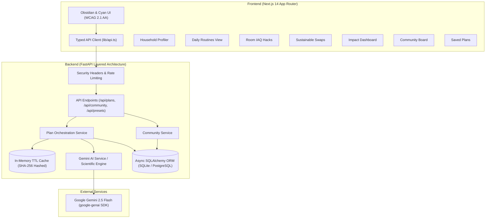

# VayuCare — GenAI Smog & Indoor Air Quality (IAQ) Copilot


**VayuCare** is a production-grade, full-stack GenAI web application designed to help families and urban communities navigate severe winter smog crises, hazardous thermal inversions, and chronic particulate pollution (PM2.5 / PM10 / NO2 / black carbon).

Powered by the **Google Gemini SDK (`google-genai`)** with structured JSON output, async SQLAlchemy persistence, deterministic in-memory caching, and WCAG 2.1 AA accessible UI design, VayuCare delivers actionable daily schedules, room-by-room indoor air quality (IAQ) protocols, budget-tiered sustainable alternatives, and transparent scientific reasoning for every single recommendation.

---

## Table of Contents
1. [Core Features](#core-features)
2. [Architectural Overview](#architectural-overview)
3. [Quality Standards & Engineering Rigor](#quality-standards--engineering-rigor)
4. [Tech Stack](#tech-stack)
5. [Getting Started & Local Setup](#getting-started--local-setup)
6. [Environment Variables](#environment-variables)
7. [Running Automated Tests](#running-automated-tests)
8. [Security Controls](#security-controls)
9. [Accessibility (WCAG 2.1 AA)](#accessibility-wcag-21-aa)
10. [API Documentation](#api-documentation)

---

## Core Features

### 1. Household & Location Profiler with Realistic Presets
- Custom input for city, neighborhood, current ambient AQI (0 to 999 scale), housing typology (high-rise apartment, ground floor, independent house, unsealed flat), floor elevation, cooking fuel, heating source, and air purifier ownership.
- Dynamic household member vulnerability builder: track infants (developing lungs), school children, pregnant individuals, seniors (cardiovascular vulnerability), asthmatics / COPD patients, and daily commuters.
- **One-click realistic presets** for rapid exploration:
  - *Delhi NCR Winter Severe AQI 420*: Multigenerational family with 3rd-floor thermal inversion peak, school-age child, and asthmatic senior.
  - *Lahore Smog Crisis AQI 560+*: Emergency Indo-Gangetic basin crisis with newborn infant and ground-floor motorcycle commuters.
  - *Mumbai Coastal Smog AQI 185*: Ground-floor studio resident with active asthma and coastal humidity particulate coagulation.
  - *Kolkata Traffic Corridor AQI 310*: 8th-floor high-rise apartment near arterial roadways with pregnant resident and bus transit.

### 2. Low-Emission Daily Routines
- Time-blocked daily schedule: *Early Morning* (06:00 - 08:30 Inversion Peak), *Outbound Commute*, *Midday Afternoon* (Solar Dilution Window), *Return Commute*, and *Night Sleep Sanctuary*.
- Ambient exposure indicators: clear warnings for when outdoor air is hazardous vs. narrow safer solar windows.
- Strict respirator guidelines: N95 / FFP2 / KF94 fitment instructions vs. failure modes of surgical and cloth masks.

### 3. Room-by-Room IAQ Blueprint
- Actionable steps tailored to specific home layouts and vulnerable family members:
  - **Ventilation Timing vs. Sealing**: Exact schedule on when to flush rooms vs. applying silicone weatherstripping tape to sash gaps.
  - **Purification Vectors**: Strategic placement of HEPA purifiers (distance from walls, intake alignment) and step-by-step DIY Corsi-Rosenthal Box specs (20-inch box fan + 4 MERV 13 filters delivering >250 CFM CADR).
  - **Micro-Dust & Chemical Control**: Microfiber damp mopping protocols, prohibition of dry broom sweeping, zero incense (agarbatti), mosquito coils, or VOC sprays.
  - **Cooking Aerosol Containment**: Induction stoves, lid-sealed pressure cooking, and pre-exhaust ventilation to prevent sub-micron lipid smoke dispersal.

### 4. Sustainable Alternatives & Carbon Swaps
- Practical swaps tiered by budget (*Minimal/Free*, *Moderate*, *Comprehensive*).
- Categories: Commute transit, home space heating (inverter heat pumps vs. unvented combustion angithis), cooking energy, and community green action.
- Every swap quantifies monthly emission reductions (kg CO2e) and financial cost impact.

### 5. Transparent Scientific Reasoning
Every recommendation provides:
- **Why It Works**: The physical, aerodynamic, or chemical mechanism explained in plain language.
- **Estimated Direct Impact**: Honest ranges (e.g. "65% - 85% exposure drop", "75 - 88% indoor PM2.5 reduction").
- **Clear Assumptions & Confidence Level**: Explicit disclosure of boundary conditions (e.g., door seals, facial fit) and empirical confidence grades (`high`, `medium`, `low`).

### 6. Community Smog Action Board & Saved Plans
- Collective neighborhood smog initiatives: zero leaf-burning patrols, school gate anti-idling zones, senior citizen DIY purifier drives, and electric carpool pods.
- Upvote and filter community actions by city and category.
- Revisit, compare side-by-side, bookmark favorites, and share customized plans via public URL tokens.

---

## Architectural Overview



---

## Quality Standards & Engineering Rigor

1. **Clean Layered Architecture**: Clear separation of `core/` (config, security, cache), `models/` (Pydantic schemas and SQLAlchemy ORM), `services/` (business logic and Gemini client), and `routes/` (REST endpoints).
2. **Strict Typing**: Full Python type hints with Pydantic v2 schemas and TypeScript strict mode across frontend with zero `any` types.
3. **Resilient Fallback Engine**: If `GEMINI_API_KEY` is not provided or upstream encounters network timeouts, the system automatically falls back to an expert, deterministic scientific synthesis engine calculated using empirical atmospheric and building physics. Zero stubbed endpoints or dead code.
4. **Deterministic In-Memory Cache**: Incoming payloads are normalized and hashed using SHA-256. Identical queries return instantaneously from cache with `is_cached: true`.
5. **Security Hardened**: Explicit CORS origin allowlists (never wildcard with credentials), security headers (`nosniff`, `DENY`, strict referrer), sliding-window rate limiting, and sanitized error messages preventing stack trace leakage.

---

## Tech Stack

- **Backend**: Python 3.11+, FastAPI, Pydantic v2, `pydantic-settings`, SQLAlchemy 2.0 (async), `aiosqlite` (or `asyncpg`), Google Gemini SDK (`google-genai`), `httpx`, `pytest`, `pytest-asyncio`.
- **Frontend**: Next.js 14.2 (App Router), TypeScript 5 (Strict Mode), Tailwind CSS, Lucide React, Vitest, React Testing Library, jsdom.
- **CI / CD**: GitHub Actions workflow testing backend (`pytest`) and frontend (`lint`, `typecheck`, `vitest`, `build`).

---

## Getting Started & Local Setup

### Prerequisites
- Python 3.11 or higher
- Node.js 18.18+ or 20+
- npm 9+ or 10+

### 1. Clone & Setup Repository
```bash
git clone https://github.com/example/vayucare.git
cd vayucare
```

### 2. Backend Setup
```bash
# Navigate to backend and create virtual environment
cd backend
python -m venv venv

# Activate virtual environment
# Windows:
venv\Scripts\activate
# Linux/macOS:
# source venv/bin/activate

# Install dependencies
pip install -r requirements.txt

# Configure environment variables
copy .env.example .env   # (or cp .env.example .env on Unix)

# Start backend server
uvicorn backend.main:app --host 0.0.0.0 --port 8000 --reload
```
The backend API is now live at `http://localhost:8000`. Interactive OpenAPI documentation is available at `http://localhost:8000/docs`.

### 3. Frontend Setup
In a new terminal window:
```bash
cd frontend

# Install dependencies
npm install

# Configure environment variables
copy .env.example .env.local   # (or cp .env.example .env.local on Unix)

# Start development server
npm run dev
```
The frontend is now accessible at `http://localhost:3000`.

---

## Environment Variables

### Backend (`backend/.env`)
| Variable | Description | Default |
|---|---|---|
| `ENVIRONMENT` | Application mode (`development`, `testing`, `production`) | `development` |
| `LOG_LEVEL` | Logging verbosity (`info`, `debug`, `warning`) | `info` |
| `PORT` | HTTP server port | `8000` |
| `HOST` | Bind address | `0.0.0.0` |
| `GEMINI_API_KEY` | Google Gemini API Key from Google AI Studio | `""` (falls back to scientific engine) |
| `GEMINI_MODEL` | Google Gemini model identifier | `gemini-2.5-flash` |
| `DATABASE_URL` | Async SQLAlchemy database URL | `sqlite+aiosqlite:///./vayucare.db` |
| `ALLOWED_ORIGINS` | Comma-separated list of allowed CORS origins | `http://localhost:3000,http://127.0.0.1:3000` |
| `RATE_LIMIT_PER_MINUTE` | Max plan generation calls allowed per IP per minute | `60` |
| `CACHE_TTL_SECONDS` | In-memory plan cache time-to-live | `3600` |

### Frontend (`frontend/.env.local`)
| Variable | Description | Default |
|---|---|---|
| `NEXT_PUBLIC_API_URL` | Base URL of the VayuCare FastAPI backend | `http://localhost:8000` |

---

## Running Automated Tests

### 1. Backend Automated Tests (`pytest` + `pytest-asyncio` + `httpx`)
Runs 8 test suites verifying health probes, security response headers, schema validation, cache hits, input validation boundaries, upstream timeout handling, plan CRUD, and community pledges:
```bash
# From workspace root
backend\venv\Scripts\python.exe -m pytest backend
```
Expected output:
```text
backend\tests\test_api.py::test_health_check_and_security_headers PASSED
backend\tests\test_api.py::test_ready_check PASSED
backend\tests\test_api.py::test_scenario_presets_endpoint PASSED
backend\tests\test_api.py::test_valid_plan_generation_and_caching PASSED
backend\tests\test_api.py::test_input_validation_edge_cases PASSED
backend\tests\test_api.py::test_upstream_gemini_failure_graceful_handling PASSED
backend\tests\test_api.py::test_saved_plans_crud_lifecycle PASSED
backend\tests\test_api.py::test_community_pledges_board PASSED
============================== 8 passed in 0.62s ==============================
```

### 2. Frontend Automated Tests (`Vitest` + React Testing Library)
Runs 8 test suites verifying Navbar accessibility roles, Profiler form submission and validation feedback, routines rendering, room IAQ blueprint, sustainable swaps, impact cards, and preset scenarios:
```bash
# From workspace root
npm --prefix frontend test
```
Expected output:
```text
 ✓ test/components.test.tsx (8 tests) 443ms
 Test Files  1 passed (1)
      Tests  8 passed (8)
```

### 3. Frontend Type Checking
```bash
npm --prefix frontend run typecheck
```

### 4. Frontend Linting
```bash
npm --prefix frontend run lint
```

### 5. Frontend Production Build
```bash
npm --prefix frontend run build
```

---

## Security Controls

- **No Secret Leakage**: All keys loaded via `pydantic-settings` from environment variables. Git repository ignores all `.env*` files.
- **Input Sanitization & Validation**:
  - AQI restricted to integer bounds `[0, 999]`.
  - String inputs bounded with `min_length` and `max_length`.
  - Categorical selections enforced by strict Enums (`HousingType`, `CommuteMode`, `MemberRole`, etc.).
- **Hardened HTTP Response Headers**:
  - `X-Content-Type-Options: nosniff`
  - `X-Frame-Options: DENY`
  - `Referrer-Policy: strict-origin-when-cross-origin`
  - `Permissions-Policy: geolocation=(), camera=(), microphone=()`
  - `X-XSS-Protection: 1; mode=block`
- **Rate Limiting**: Sliding-window limiter on `/api/plans/generate` throttling abusive IPs (default 60 requests/minute).
- **Sanitized Error Responses**: Custom exception handlers trap unexpected server errors and return clean JSON without exposing internal traceback frames.

---

## Accessibility (WCAG 2.1 AA)

- **Color Contrast**: Dark Obsidian background (`#090D16`) paired with high-contrast text (`#F8FAFC`, `#94A3B8`) and vibrant accents (`#22D3EE`, `#10B981`) exceeding the minimum 4.5:1 contrast ratio.
- **Semantic Landmarks**: Semantic HTML5 tags (`<header>`, `<nav>`, `<main id="main-content">`, `<section>`, `<article>`, `<footer>`).
- **Skip Link**: Accessible `<a href="#main-content" className="skip-link">Skip to main content</a>` positioned at the top of the DOM.
- **Form Controls**: Every form field explicitly bound to a descriptive `<label htmlFor="...">`.
- **Keyboard Focus**: Visible `:focus-visible` styling (`outline: 2px solid #22d3ee; outline-offset: 2px;`) across all interactive controls.
- **Screen Reader Announcements**: `aria-live="polite"` regions inform assistive technology when plans are generated or notifications triggered.
- **ARIA Roles**: Accordions, tabs (`role="tablist"`, `role="tab"`), and modals (`role="dialog"`, `aria-modal="true"`) conform to WAI-ARIA standards.

---

## API Documentation

### Key Endpoints
| Method | Path | Description |
|---|---|---|
| `GET` | `/health` | Service liveness probe and cache statistics |
| `GET` | `/ready` | Database connection readiness probe |
| `GET` | `/api/presets` | List realistic scenario presets (Delhi, Lahore, Mumbai, Kolkata) |
| `POST` | `/api/plans/generate` | Synthesize or retrieve cached personalized smog action plan |
| `GET` | `/api/plans` | List saved plans with summary metadata |
| `GET` | `/api/plans/{id}` | Retrieve complete saved plan by UUID |
| `GET` | `/api/plans/share/{slug}` | Retrieve shared plan by public URL slug |
| `PATCH` | `/api/plans/{id}/favorite` | Toggle plan bookmark status |
| `DELETE` | `/api/plans/{id}` | Delete saved plan |
| `GET` | `/api/community/pledges` | List community smog action pledges (filter by city / type) |
| `POST` | `/api/community/pledges` | Publish a new community action pledge |
| `POST` | `/api/community/pledges/{id}/upvote` | Upvote an existing community pledge |

---

## License
MIT License. Built for community health, clean air advocacy, and urban resilience.
